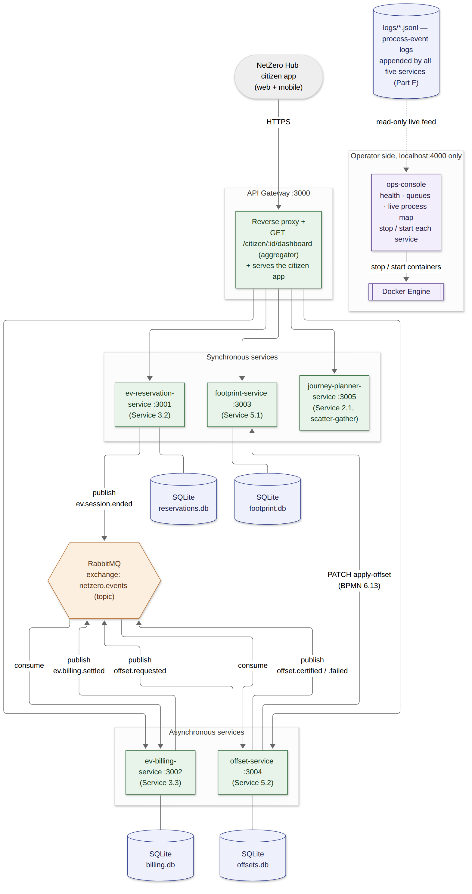
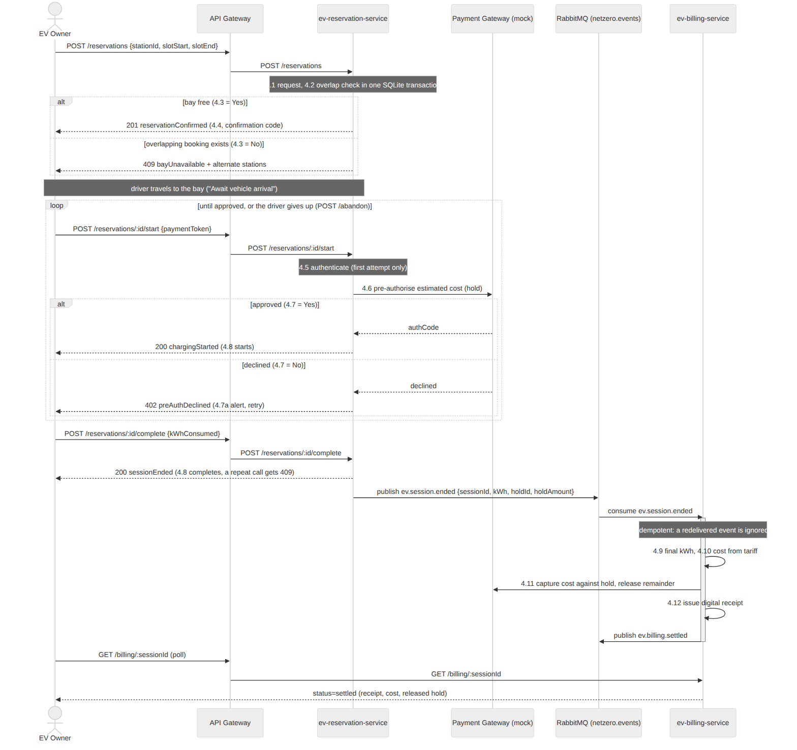
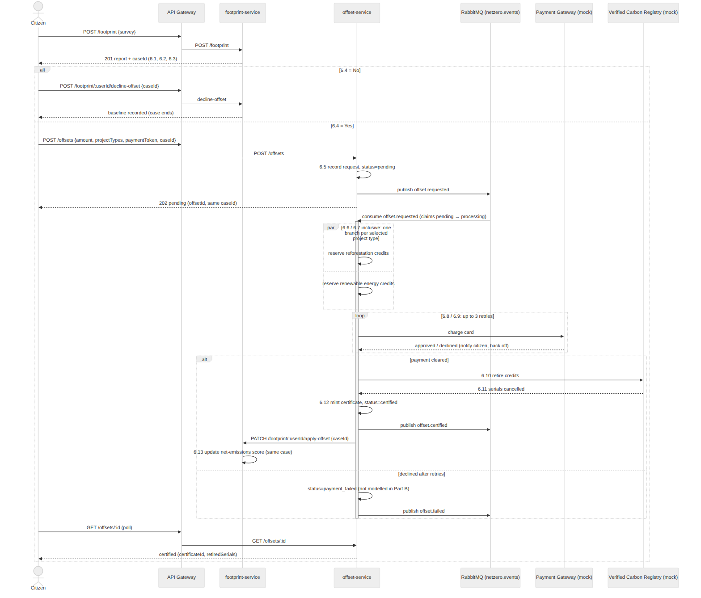
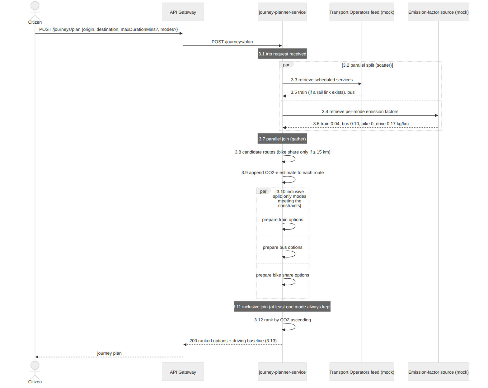
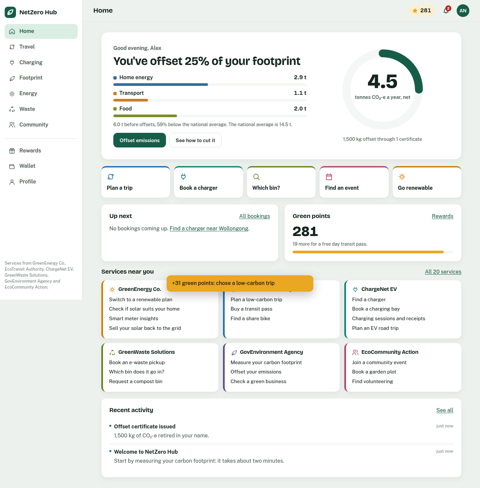
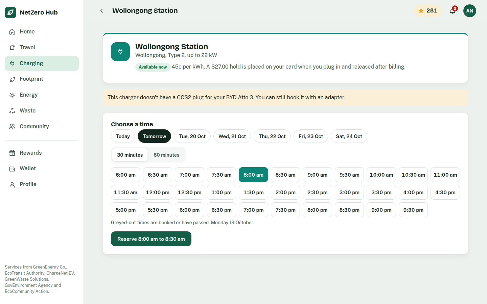
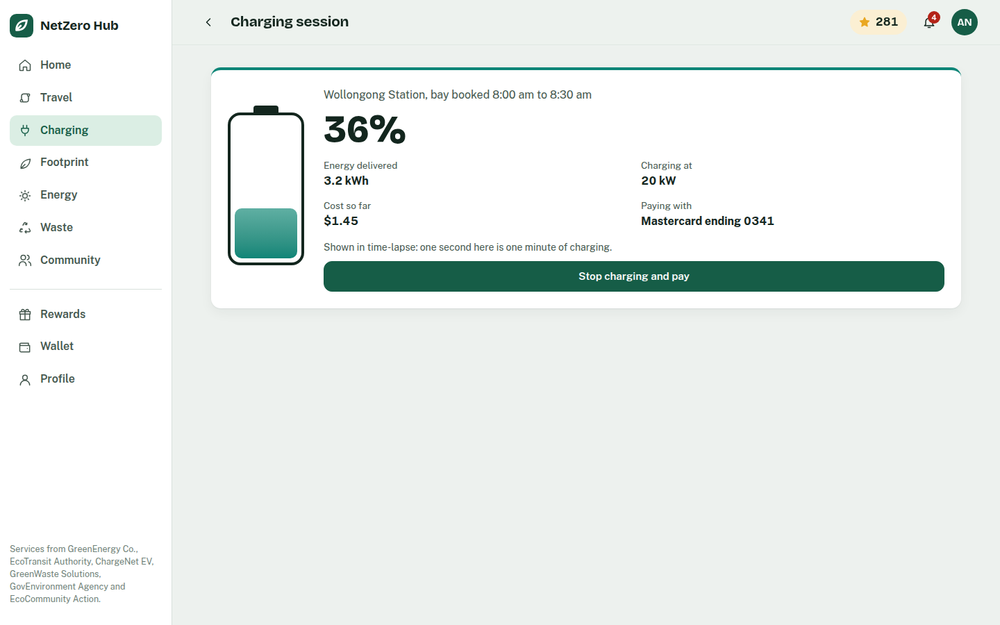
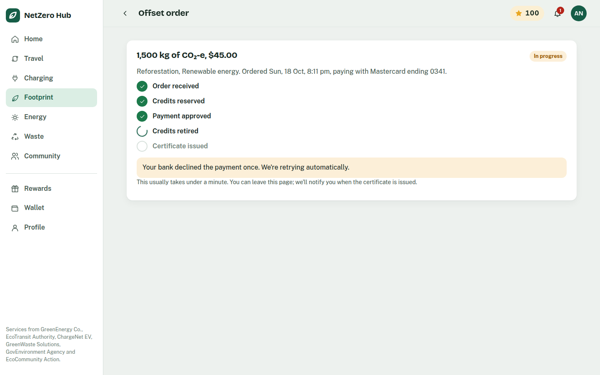
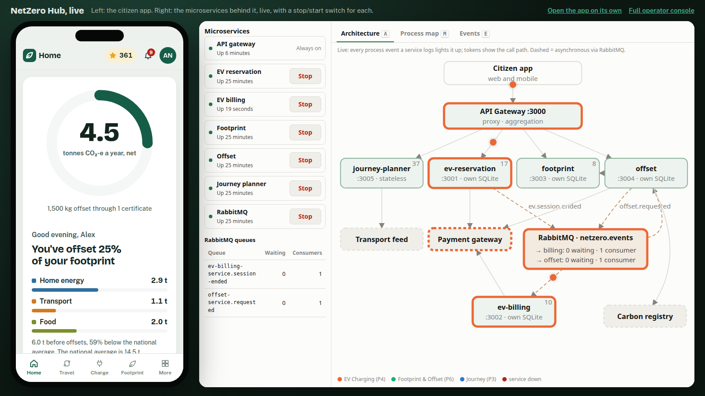
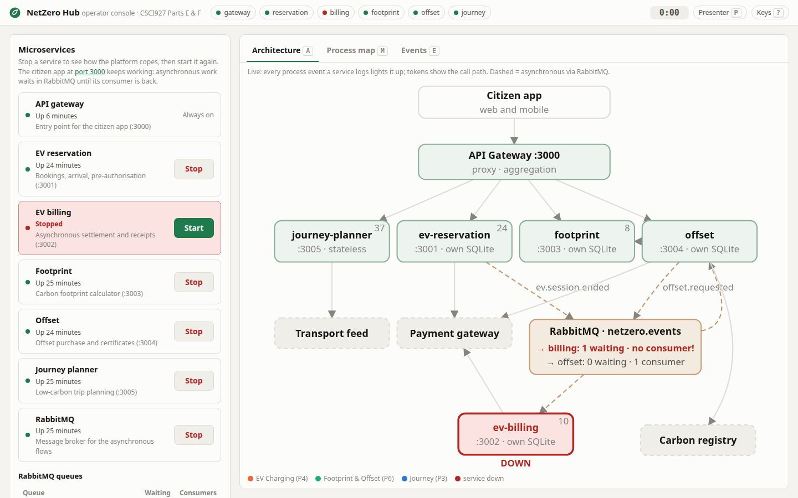

PART E

**NetZero Hub — Service-Oriented Software Engineering**

**Part E — Microservices Design and Implementation**

## E.0 Approach and Service Selection

This section selects five services from the platform designed in Parts A–C and implements each as an independently deployable microservice, backed by a working, containerised system rather than a design exercise alone (Week 12 requires a live product demonstration of this part specifically).

Rather than picking five arbitrary services, the selection deliberately reuses work already established in earlier parts, so that Part E's design is traceable end-to-end back to the BSRL specifications (Part A), the BPMN process models (Part B) and the SoaML service contracts (Part C), instead of starting a parallel design:

| # | Microservice | Part A service | Part B process (lane) | Part C service contract | Communication pattern |
| --- | --- | --- | --- | --- | --- |
| 1 | `ev-reservation-service` | 3.2 Charging Bay Reservation | Process 4 (RSVP management, 4.1–4.8) | Contract 3 (Fig. C.8–C.9) | Synchronous, alt fragment |
| 2 | `ev-billing-service` | 3.3 Automated EV Billing & Payment | Process 4 (Billing, 4.9–4.12) | Contract 4 (Fig. C.10–C.11) | Asynchronous, event-driven |
| 3 | `footprint-service` | 5.1 Individual Carbon Footprint Calculator | Process 6 (Assessment, 6.1–6.4, 6.13) | Contract 6 (Fig. C.14–C.15) | Synchronous |
| 4 | `offset-service` | 5.2 Carbon Offset Purchasing | Process 6 (Offset marketplace, 6.5–6.12) | Contract 7 (Fig. C.16–C.17) | Asynchronous, event-driven |
| 5 | `journey-planner-service` | 2.1 Carbon-Optimized Journey Planner | Process 3 (3.1–3.13) | Contract 2 (Fig. C.6–C.7) | Synchronous, scatter-gather |

Services 1–2 and 3–4 are exactly the two compositions built in Part C §C.3 (EV Charging Session, and Environmental Services). Implementing both halves of each composition as separate microservices lets Part E demonstrate genuine inter-service communication: one service's completed transaction is what triggers the next, rather than five unrelated services that never talk to each other. Service 5 broadens coverage to a third provider (EcoTransit Authority) and exercises a different microservices concern: a stateless aggregating/orchestrating service that calls other data sources in parallel.

The service boundaries follow the BPMN swim-lanes. In Process 4, the "RSVP management" lane (reservation, arrival, pre-authorisation, charging) is `ev-reservation-service` and the "Billing" lane is `ev-billing-service`. In Process 6, the "Assessment Service" lane is `footprint-service` and the offset marketplace is `offset-service`. Each microservice therefore owns one coherent business capability and its data, which is the decomposition-by-business-capability rule for microservices.

Three architectural decisions were made once and applied consistently across all five services:

- **Database-per-service.** Each of the four data-owning services has its own SQLite file in its own Docker volume. No service ever queries another's database directly; the only way to read or change another service's data is through its public API (for example, `offset-service` updates a citizen's net-emissions score by calling `footprint-service`, not by writing to its table). `journey-planner-service` is deliberately stateless.
- **Synchronous where the outcome is known immediately, asynchronous where it genuinely isn't.** This mirrors the distinction Part C draws between its service contracts (§C.0): a contract is asynchronous "because its underlying BPMN model from Part B genuinely involves a delay before the outcome is known". `ev-billing-service` cannot settle until a session has ended and the payment gateway responds, and `offset-service` cannot certify until the payment and the registry retirement complete. Both are therefore event consumers rather than functions with a return value, and RabbitMQ carries the asynchronous outcome. `ev-reservation-service`, `footprint-service` and `journey-planner-service` resolve in a single round trip and are plain REST endpoints.
- **Every BPMN activity is observable.** Each service writes a case-correlated process-event log keyed to the Part B element numbers (§E.5). This makes Part F's process mining possible without changing the services.

## E.1 Overall Architecture



*Figure E.1 — Deployment/component architecture: API Gateway, five microservices, RabbitMQ, one SQLite database per data-owning service, the shared process-event log, and the operator console.*

The system is deployed as six application containers plus a broker, with an operator console beside them:

- **`api-gateway`** is the platform's single external entry point, corresponding directly to the Aggregator port on the Hub side of Part C's Figure C.2 ParticipantArchitecture. It reverse-proxies `/api/<resource>` to the owning service, and exposes one genuine aggregation endpoint, `GET /api/citizen/:userId/dashboard`. That endpoint fans out to `footprint-service`, `offset-service` and `ev-reservation-service` in parallel and, for every ended charging session, cross-references `ev-billing-service`, composing a single citizen view from four services. It also serves the NetZero Hub citizen app, and nothing else: operator tooling is kept off the citizen port.

- **`ops-console`** (port 4000, published on localhost only) is the operator side of the platform. It reports every service's health, RabbitMQ queue depth and consumer count, and a read-only tail of the process-event logs, and it can **stop and start each microservice and the broker** through the Docker Engine API. Because the Docker socket is root-equivalent on the host, the control endpoints are restricted to this compose project's own services (the gateway excluded), to the two actions stop and start, and to requests carrying an `X-Ops-Console` header, which a browser will not send cross-site without a CORS preflight the console never approves.
- **RabbitMQ** provides one durable topic exchange, `netzero.events`. `ev-reservation-service` publishes `ev.session.ended`, which `ev-billing-service` consumes; billing then publishes `ev.billing.settled`. `offset-service` publishes and consumes its own `offset.requested` event to hand work to its background worker, then publishes `offset.certified` or `offset.failed`. A real broker (rather than delayed HTTP callbacks) was chosen so the asynchronous nature of these two contracts is genuine: the publisher returns immediately, messages survive a consumer restart (durable queue, persistent messages), and a consumer that is down catches up when it returns.
- Each service is independently built, deployed and scaled (`docker-compose.yml`), and each stateful service owns an isolated volume.

## E.2 Per-Service Design and Implementation

### E.2.1 EV Charging Reservation Service (`ev-reservation-service`, port 3001)

Realises Part A Service 3.2, Part C Service Contract 3, and the "RSVP management" lane of Process 4. Every endpoint is synchronous. The reservation itself returns the alt fragment of Figure C.9: either a confirmed reservation, or a list of alternate stations if the slot is taken.

| Endpoint | Method | Purpose | BPMN |
| --- | --- | --- | --- |
| `/reservations` | POST | Reserve a bay for a station/time slot (`201`, or `409` + alternates) | 4.1, 4.2, 4.3, 4.4 |
| `/reservations/:id/start` | POST | Driver arrives: authenticate, pre-authorise the estimated cost; `402` if declined (retry by calling again) | 4.5, 4.6, 4.7/4.7a, 4.8 start |
| `/reservations/:id/complete` | POST | Driver unplugs; publishes `ev.session.ended` (only from `charging`, so a repeat call gets `409`) | 4.8 complete |
| `/reservations/:id/no-show` | POST | Arrival window lapsed (fired by a scheduler in production) | — (not in Part B) |
| `/reservations/:id/abandon` | POST | Driver gives up after declined pre-authorisations | — (not in Part B) |
| `/reservations/:id/cancel` | POST | Driver cancels a confirmed booking (frees the bay) | — (not in Part B) |
| `/stations` | GET | Station catalogue with live status (available, reserved now, in use), Part A Service 3.1 | |
| `/stations/:id/availability?from=&to=` | GET | Booked intervals at one station, so a client can grey out taken slots (no user data exposed) | |
| `/reservations/:id` | GET | Retrieve one reservation | |
| `/reservations?userId=` | GET | A citizen's reservations (used by the gateway dashboard) | |

**Data model:** `reservations(id, station_id, user_id, slot_start, slot_end, status, confirmation_code, preauth_attempts, hold_id, hold_amount, session_started_at, kwh_consumed, created_at, updated_at)`. The reservation's lifecycle is an explicit state machine, and every endpoint checks the current state before acting:

```
confirmed ──start(approved)──▶ charging ──complete──▶ session_ended
    │  └──start(declined)──▶ preauth_declined ──start(approved)──▶ charging
    │                              └──abandon──▶ abandoned
    └──no-show──▶ expired
```

Part A's QoS factor for this service is explicit: "Double Booking Rate = 0%". Slots are compared as intervals, not just by start time. A 09:15–09:45 request is rejected if 09:00–09:30 is already booked. The overlap test and the insert run inside one SQLite transaction, so two overlapping requests can never both succeed:

```typescript
const tryBook = db.transaction((id, stationId, userId, slotStart, slotEnd, code) => {
  const conflict = db.prepare(
    `SELECT id FROM reservations
     WHERE station_id = ? AND status IN ('confirmed','preauth_declined','charging','session_ended')
       AND slot_start < ? AND slot_end > ?          -- standard interval-overlap test
     LIMIT 1`
  ).get(stationId, slotEnd, slotStart);
  if (conflict) return { booked: false, conflict };
  db.prepare(`INSERT INTO reservations (...) VALUES (?, ?, ?, ?, ?, 'confirmed', ?)`).run(/* ... */);
  return { booked: true };
});
```

Timestamps are normalised to ISO-8601 UTC on the way in, so string comparison in SQL is time comparison. Requests with an end before their start are rejected with `400`. Expired and abandoned reservations no longer occupy the bay.

Pre-authorisation follows BPMN 4.6/4.7/4.7a exactly: a declined hold returns `402` with an alert, and the driver retries by calling `/start` again, which loops back to 4.6 without repeating authentication (4.5). The estimated hold (60 kWh × tariff = AU$27.00) is carried in the `ev.session.ended` event, so billing can capture against it.

### E.2.2 EV Billing Service (`ev-billing-service`, port 3002)

Realises Part A Service 3.3, Part C Service Contract 4, and the "Billing" lane of Process 4 (4.9–4.12). It is asynchronous by necessity: settlement cannot start until the session ends, and the capture outcome comes from the payment gateway. The service never receives a direct HTTP call to start billing; it is driven entirely by consuming `ev.session.ended`, mirroring Part C's note that the consumer role is the charging session rather than the driver.

| Endpoint | Method | Purpose |
| --- | --- | --- |
| `/billing/:sessionId` | GET | Poll for the (asynchronously produced) receipt |
| `/billing?userId=` | GET | A citizen's billing history |
| *(consumes)* `ev.session.ended` | — | Triggers settlement (4.9 → 4.12) |
| *(publishes)* `ev.billing.settled` | — | `CustomerNotificationInterface`-equivalent event |

**Data model:** `bills(session_id, user_id, station_id, kwh, session_seconds, tariff_per_kwh, cost, hold_id, hold_amount, released_amount, transaction_id, status, receipt_id, created_at, updated_at)`.

RabbitMQ delivers at least once, so the consumer is **idempotent**. It claims the session with an `INSERT … ON CONFLICT DO NOTHING` before doing any work, and a redelivered event is acknowledged and ignored instead of producing a second charge:

```typescript
const claimed = db.prepare(
  `INSERT INTO bills (session_id, ..., status) VALUES (?, ..., 'settling')
   ON CONFLICT(session_id) DO NOTHING`
).run(sessionId, /* ... */);
if (claimed.changes === 0) return;              // duplicate delivery: already billed

// 4.9 final kWh and duration -> 4.10 cost from tariff
const cost = Number((kWhConsumed * TARIFF_PER_KWH).toFixed(2));
// 4.11 / 4.11a capture against the pre-authorisation hold, release the remainder
const result = await capture(holdId, holdAmount, cost);
// 4.12 issue receipt, then announce it
await publishEvent("ev.billing.settled", { sessionId, userId, cost, receiptId, releasedAmount: result.released });
```

Payment failure is handled where Part B puts it, at pre-authorisation (4.7a, in `ev-reservation-service`). Once a hold is approved, capture against it does not fail in Part B's model, so settlement has no retry branch.

### E.2.3 Carbon Footprint Calculation Service (`footprint-service`, port 3003)

Realises Part A Service 5.1, Part C Service Contract 6, and the assessment lane of Process 6.

| Endpoint | Method | Purpose | BPMN |
| --- | --- | --- | --- |
| `/footprint` | POST | Calculate and store a citizen's footprint report; returns its `caseId` | 6.1, 6.2, 6.3 |
| `/footprint/:userId/decline-offset` | POST | Citizen answers "No" at 6.4: baseline recorded, case ends | 6.4 (No) |
| `/footprint/:userId/apply-offset` | PATCH | Called by `offset-service` once credits are retired | 6.13 |
| `/footprint/:userId` | GET | Retrieve the stored report, including the energy, transport and food breakdown | |

**Data model:** `footprints(user_id, case_id, energy_kwh_month, transport_km_week, diet_score, total_co2_kg_year, peer_average_co2_kg_year, percentile_vs_peers, net_offset_applied_kg, created_at, updated_at)`.

Emission factors are named, adjustable constants rather than a black-box formula. That transparency is what Part A's QoS factors imply ("Calculation Accuracy ≥ 90%" is only meaningful if the calculation itself is inspectable):

```typescript
const GRID_EMISSION_FACTOR_KG_PER_KWH = 0.7;       // AU national grid average, illustrative
const TRANSPORT_EMISSION_FACTOR_KG_PER_KM = 0.17;  // average passenger car
const DIET_FACTOR_KG_PER_YEAR = { 1: 500, 2: 1000, 3: 1500, 4: 2000, 5: 2600 };
const PEER_AVERAGE_CO2_KG_YEAR = 14500;
```

Inputs are validated: energy and transport must be non-negative numbers, and the diet score must be an integer from 1 to 5.

### E.2.4 Carbon Offset Purchase Service (`offset-service`, port 3004)

Realises Part A Service 5.2, Part C Service Contract 7, and the offset-marketplace lane of Process 6 (6.5–6.12). A purchase is accepted synchronously (`202 pending`) and fulfilled asynchronously by a worker that consumes the service's own `offset.requested` event.

| Endpoint | Method | Purpose |
| --- | --- | --- |
| `/offsets` | POST | Accept a purchase (6.4 = Yes, 6.5); returns `202 pending`. Optional `caseId` = the footprint's case |
| `/offsets/:id` | GET | Poll for the certificate and the fulfilment `stage` (queued, reserving, paying, retiring, certified or payment_failed); the payment token is never returned |
| `/offsets?userId=` | GET | A citizen's offset history |
| *(publishes + consumes)* `offset.requested` | — | Hand-off to the fulfilment worker |
| *(publishes)* `offset.certified` / `offset.failed` | — | `OffsetNotificationInterface`-equivalent events |

**Data model:** `offsets(id, case_id, user_id, amount_co2_kg, project_types, price_aud, payment_token, status, certificate_id, retired_serials, retry_count, created_at, updated_at)`. Project types are validated against the three branches of Part B's inclusive gateway 6.6: `reforestation`, `renewable` and `waste-recycling`.

The worker reproduces each BPMN construct of Process 6: the inclusive split/join over the selected project types (6.6/6.7) runs as concurrent branches; payment (6.8) retries with back-off after a decline (6.9); then registry retirement (6.10/6.11), certificate (6.12) and the callback that updates the citizen's score (6.13):

```typescript
async function fulfil(offsetId: string) {
  // Idempotent: only a 'pending' request is claimed, so a redelivered message cannot charge twice.
  const claimed = db.prepare(`UPDATE offsets SET status='processing' WHERE id=? AND status='pending'`).run(offsetId);
  if (claimed.changes === 0) return;
  const row = db.prepare(`SELECT * FROM offsets WHERE id = ?`).get(offsetId);

  await reserveCredits(row.case_id, offsetId, JSON.parse(row.project_types), row.amount_co2_kg); // 6.6 ‖ 6.7
  if (!(await takePayment(row))) {                       // 6.8 with the 6.9 retry loop
    markCancelled(offsetId);                             // after MAX_RETRIES: not modelled in Part B
    return publishEvent("offset.failed", { offsetId /* ... */ });
  }
  const serials = await retireCredits(row);              // 6.10 / 6.11 (registry round trip)
  const certificateId = mintCertificate(row, serials);   // 6.12
  await publishEvent("offset.certified", { offsetId, certificateId /* ... */ });
  await notifyFootprintService(row.user_id, row.case_id, row.amount_co2_kg, certificateId); // 6.13
}
```

(Abridged from `fulfil()` in `services/offset-service/src/index.ts`. In the source, the retirement, certificate and cancellation steps are written inline rather than as the helper functions named here.)

### E.2.5 Carbon-Optimized Journey Planner Service (`journey-planner-service`, port 3005)

Realises Part A Service 2.1, Part C Service Contract 2, and Process 3. Architecturally distinct from the other four: a stateless orchestrator that scatters two calls in parallel, gathers them, then prepares one option per qualifying mode behind an inclusive gateway.

| Endpoint | Method | Purpose |
| --- | --- | --- |
| `/journeys/plan` | POST | `{origin, destination, maxDurationMins?, modes?}` → modes ranked by CO₂, plus a driving baseline |

```typescript
// 3.2 parallel split: both upstream calls in flight at once
const [transitOptions, emissionFactors] = await Promise.all([timetableP, factorsP]);
// 3.7 parallel join: execution only reaches here once both have resolved

// 3.10 inclusive split: every mode meeting the traveller's constraints, one, some or all
let qualifying = candidates.filter(
  (c) => preferredModes.includes(c.mode) && (maxDurationMins == null || c.durationMins <= maxDurationMins));
if (qualifying.length === 0) qualifying = [fastest(candidates)];   // invariant: at least one mode qualifies
await Promise.all(qualifying.map(prepareOption));                  // 3.11 joins exactly the activated branches
const ranked = [...qualifying].sort((a, b) => a.co2Kg - b.co2Kg);  // 3.12
```

The modes are the three branches drawn in the Part B diagram: bus, train and bike share. Train is offered only where a rail link exists, and bike share only for trips of 15 km or less, so each branch is genuinely optional. Driving is returned as a comparison baseline ("CO₂ saved versus driving"), not as a recommended option.

## E.3 Asynchronous Choreography in Detail



*Figure E.2 — Sequence: EV Charging Session. Reservation (synchronous, with alt fragment), arrival and pre-authorisation with its retry loop, then billing settlement delivered asynchronously over RabbitMQ once the session ends.*



*Figure E.3 — Sequence: Environmental Services. Footprint (synchronous), the 6.4 decision, then the offset purchase accepted synchronously (`202`) and fulfilled asynchronously, closing the loop back on the same case in `footprint-service`.*



*Figure E.4 — Sequence: Carbon-Optimized Journey Planner. One synchronous request that scatters two calls in parallel, gathers both, and prepares the qualifying modes behind an inclusive gateway.*

Both event flows use the same event-bus module (`src/eventBus.ts`, identical in the three services that use RabbitMQ). It is built so that a broker restart or a network failure delays business events but never loses them:

- **Automatic reconnection** with exponential back-off (1 s up to 15 s), triggered by the connection's `close` and `error` events.
- **Re-subscription.** Every subscription is remembered, and its durable queue is re-declared, re-bound and re-consumed after each reconnect.
- **Publisher confirms.** Messages are published on a confirm channel and count as sent only once RabbitMQ has accepted them.
- **Outbox.** A publish that fails is held in an outbox and re-sent in order once the broker is back. (This is in memory here; a production system would persist it in the service's own database, the transactional-outbox pattern.)
- **Consumer acknowledgements** are sent only after the handler succeeds. A failed message is requeued once and dropped on a second failure, so one poison message cannot block the queue.

```typescript
export async function publishEvent(routingKey: string, payload: unknown) {
  if (outbox.length) { outbox.push({ routingKey, payload }); void flushOutbox(); return; }  // keep ordering
  try {
    await publishNow(routingKey, payload);            // confirm channel: resolves once the broker has the message
  } catch (err) {
    outbox.push({ routingKey, payload });             // broker unreachable: hold it and retry in order
    scheduleReconnect();                              // back-off reconnect; flushOutbox() runs on success
  }
}
```

This was tested by stopping RabbitMQ completely while a charging session was ending. `ev-reservation-service` logged "held in outbox for retry", reconnected when the broker returned, and delivered `ev.session.ended`. The consumer re-subscribed automatically and the session was billed 13 seconds after the broker came back. A second test stopped `ev-billing-service` itself: the event waited in the durable queue (visible in the operator console as "1 waiting · no consumer") and was settled as soon as billing restarted.

External systems that a university project cannot call for real (the bank card network, the Verified Carbon Registry, transport timetable feeds) are mocked inside the owning service with realistic latency. The mock payment gateway is deterministic by token, so the demo and the Part F simulator can drive every BPMN branch on purpose: `tok_ok` approves, `tok_decline_<n>` declines the first *n* attempts, and `tok_decline_all` always declines.

## E.4 Deployment

The full stack (API gateway, five microservices and RabbitMQ) is defined in one `docker-compose.yml` and brought up with one command:

```bash
docker compose up --build -d
```

Each data-owning service gets its own named volume (`reservation_data`, `billing_data`, `footprint_data`, `offset_data`), so the database-per-service boundary is enforced by the deployment topology, not just by convention. `ev-reservation-service`, `ev-billing-service` and `offset-service` wait for RabbitMQ's health check before starting. Schema changes are versioned with SQLite's `user_version`, so an older demo database is rebuilt automatically rather than crashing the service.

The Part F tooling (simulator, log exporter, process miner) is defined in the same file under a `tools` profile, so it is never started by `up` and runs on demand (`./partf.sh`).

## E.5 Logging and Process-Mining Readiness

Every one of the five services is instrumented with two independent logging layers:

**Application logging.** A small dependency-free structured logger (`src/logger.ts`, identical across all six components) writes JSON lines (`timestamp`, `level`, `service`, `msg`, plus call-site fields) to stdout. An Express middleware logs every HTTP request/response pair with a generated `requestId`, status code and duration. This is conventional operational logging, orthogonal to process mining.

**Process (event) logging.** `src/processLog.ts` appends one JSON line per BPMN activity to `logs/<service>.jsonl`:

```ts
interface ProcessEvent {
  process: string;        // Part B process, e.g. "EV Charging Session"
  caseId: string;         // process instance; shared across services for a composed process
  activity: string;       // the BPMN task label from the Part B diagram
  lifecycle: "start" | "complete";
  resource: string;       // the BPMN lane/participant, e.g. "RSVP Management", "Billing", "Citizen"
  bpmnRef?: string;       // Part B element number, e.g. "4.6/4.6a" -- absent for unmodelled behaviour
  data?: Record<string, unknown>;
  timestamp: string;      // ISO-8601, generated at log time
}
```

Design decisions that target process-mining fidelity:

- **One case per process instance, including across service boundaries.** The reservation id is minted *before* step 4.1, so every attempt is exactly one case. A rejected double-booking is its own short case ending in "Suggest alternate charging bays/time", and a confirmed booking's case runs uninterrupted from 4.1 to 4.12. `ev-billing-service` continues the same case because the event carries the reservation id. `footprint-service` mints the `caseId` for an assessment, `POST /offsets` accepts that same `caseId`, and `offset-service` passes it back in the 6.13 callback, so one Environmental Services case spans two independently deployed, independently data-owned services.
- **Activity names and resources come from the Part B diagrams.** Activities use the task labels from the BPMN models, and resources are the swim-lanes, so a mined process map can be laid next to the Part B diagram and read directly. Gateways are decisions, not work, so they are recorded as data attributes (for example `bayAvailable`, `approved`, `offsetDecision`) rather than as activities.
- **Real concurrency evidence.** Parallel and inclusive branches (3.3‖3.4, the per-mode preparations at 3.10, and the per-project reservations at 6.6) are logged as overlapping `start`/`complete` pairs at the moment each branch actually starts and finishes, so discovery algorithms see true parallelism rather than an artificial sequence.
- **All paths are logged, including those Part B does not model.** Retry loops (4.7a, 6.9), the 6.4 "No" branch, and the alt-fragment rejection each have their own activity. Three behaviours the system supports but Part B's models do not are logged without a `bpmnRef`: a driver no-show, a driver abandoning after declined pre-authorisations, and an offset purchase cancelled after repeated payment declines. Part F's conformance checking is expected to find exactly these.

**Export.** `tools/log-exporter` groups every service's events by process and case, sorts each case chronologically, and writes one XES 1.0 file and one CSV per process into `exports/`. The XES declares the standard Concept/Lifecycle/Organizational/Time extensions and both classifiers, so it opens directly in Disco or Apromore with no column mapping. Part F (`docs/PART-F.md`) uses it.

## E.6 The Citizen App, Verification and Live Demo

### E.6.1 NetZero Hub citizen app

The platform's user-facing front end is a citizen app served by the gateway at `/` (`gateway/public/index.html` and `app/`). It is a dependency-free single-page app (plain ES modules, bundled fonts, no build step) with a web layout on desktop and an app layout with bottom tabs on phones, matching the Project Description's "mobile applications, web portals" channels. A resident signs up once, then uses every Part A service from the six providers in one place:

| Provider | Services in the app | Backed by |
| --- | --- | --- |
| EcoTransit Authority | 2.1 low-carbon journey planner; 2.2 transit passes; 2.3 share bikes | 2.1: `journey-planner-service`; 2.2–2.3 simulated |
| ChargeNet EV | 3.1 charger finder with live status and map; 3.2 bay booking; 3.3 charging session, pre-authorisation, receipt; 3.4 road-trip range planner | 3.1–3.3: `ev-reservation-service` + `ev-billing-service`; 3.4 simulated |
| GovEnvironment Agency | 5.1 footprint calculator; 5.2 offset purchase and certificate; 5.3 green business lookup | 5.1–5.2: `footprint-service` + `offset-service`; 5.3 simulated |
| GreenEnergy Co. | 1.1 renewable plan switch; 1.2 solar feasibility; 1.3 smart-meter insights; 1.4 solar buy-back registration | simulated |
| GreenWaste Solutions | 4.1 e-waste pickup (Process 5 checks and fix loop); 4.2 which-bin guide; 4.3 compost bin | simulated |
| EcoCommunity Action | 6.1 events with tickets and calendar invites; 6.2 garden plots; 6.3 volunteer matching | simulated |

The simulated providers are clearly separated in the code (`app/data.js` and the provider views). They follow the same rules as the real services (for example, the payment-card behaviour of the platform's payment gateway) and the Part B processes where one exists (Process 1 and 2 checks for energy, Process 5 for e-waste). Cross-cutting features tie the services together: a wallet of payment cards, green points for sustainable choices (the Project Description's "incentives for sustainable practices") with redeemable rewards, and notifications.

The app makes the microservice behaviour visible in a citizen's terms rather than a developer's:

- **The home screen's carbon ring** is the user's footprint from `footprint-service`, filling in as `offset-service` certifies offsets. The gateway's aggregation endpoint supplies it in one call.
- **Asynchronous outcomes become notifications.** After a charging session or an offset purchase, the app keeps a watch list and tells the user when the receipt or certificate is issued. If billing is down, the user is told the receipt will follow, and the notification arrives once billing recovers.
- **Failure paths are plain language.** A declined pre-authorisation (BPMN 4.7a) is explained with a retry button; offset payment retries (6.9) are shown in the progress tracker; a rejected e-waste booking lists exactly what to change.



*Figure E.5 — Citizen app home: the carbon ring (footprint net of certified offsets), green points, and notifications fed by asynchronous service outcomes.*



*Figure E.6 — Booking a charging bay: slot availability from `ev-reservation-service`; booked or past times are disabled.*



*Figure E.7 — Live charging session after the pre-authorisation hold, then the asynchronous receipt (`app-screenshots/06-async-receipt.png`).*



*Figure E.8 — Offset order tracking the fulfilment stages from `offset-service`, including an automatic payment retry, ending in the certificate (`app-screenshots/08-offset-certificate.png`).*

### E.6.2 Verification

The system was run end to end before being written up: all five services and the gateway with RabbitMQ, every endpoint above, both asynchronous round trips, and the gateway aggregation. The services pass TypeScript's strict type check (`tsc --noEmit`). The operator console's Stop/Start controls were exercised against the running stack (including a charging session ended while billing was stopped from the panel), and its security checks were confirmed: requests without the header, for the gateway, or for any other action are refused. The citizen app was driven through every screen in a headless browser at desktop and phone widths, with no script errors and no horizontal overflow, including the full flows of booking, declined card, retry, charging, billing (also with billing stopped and restarted), footprint, offset with a declined-then-approved card, and journey planning.

### E.6.3 Live demo

The Week 12 demo is told from the citizen's side on the **stage view** (`localhost:4000/stage/`): the citizen app (`localhost:3000`) in a phone frame beside the **operator console** (`localhost:4000`). The console shows:

- **Microservices panel:** each service's container state with a Stop/Start button, and the RabbitMQ queues. Stopping a service mid-flow is how the demo shows fault tolerance: the app keeps working and asynchronous work waits in its queue until the consumer is back.
- **Architecture:** the deployment diagram, animated by the services' own events. Calls travel as tokens from the app through the gateway; asynchronous hops travel through RabbitMQ; RabbitMQ shows each queue's depth and consumer count; a stopped service turns red.
- **Process map:** a directly-follows process map built in the browser from the live event stream, with behaviour outside the Part B model highlighted. It previews Part F's process mining during the demo.
- **Events:** the raw per-activity event feed, with a click-to-filter on any case id.



*Figure E.9 — Stage view: the citizen app (left) and the operator console (right) with its service controls and live architecture.*



*Figure E.10 — Failure test: ev-billing-service stopped from the console's service panel while a session ends. The service turns red and RabbitMQ shows the billing queue with one message and no consumer; after Start the receipt arrives without any retry by the user (`demo-screenshots/console-billing-recovered.png`).*

`demo.sh` (terminal, `PAUSE=1` for step-by-step presenting) remains as an API-level walkthrough and fallback. `rehearse.sh` times the 8-minute run-of-show segment by segment. See `docs/DEMO.md` for the Week 12 runbook.

## E.7 Traceability Summary

| Part A Service | Part B Process (elements) | Part C Contract | Part E Microservice | Verified |
| --- | --- | --- | --- | --- |
| 3.2 Charging Bay Reservation | Process 4 (4.1–4.8) | Contract 3 | `ev-reservation-service` | ✔ |
| 3.3 Automated EV Billing & Payment | Process 4 (4.9–4.12) | Contract 4 | `ev-billing-service` | ✔ |
| 5.1 Individual Carbon Footprint Calculator | Process 6 (6.1–6.4, 6.13) | Contract 6 | `footprint-service` | ✔ |
| 5.2 Carbon Offset Purchasing | Process 6 (6.5–6.12) | Contract 7 | `offset-service` | ✔ |
| 2.1 Carbon-Optimized Journey Planner | Process 3 (3.1–3.13) | Contract 2 | `journey-planner-service` | ✔ |

All five emit Part-F-ready process event logs (§E.5), keyed to the Part B element numbers in the table above.
