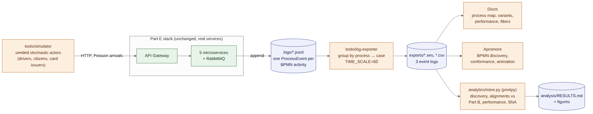
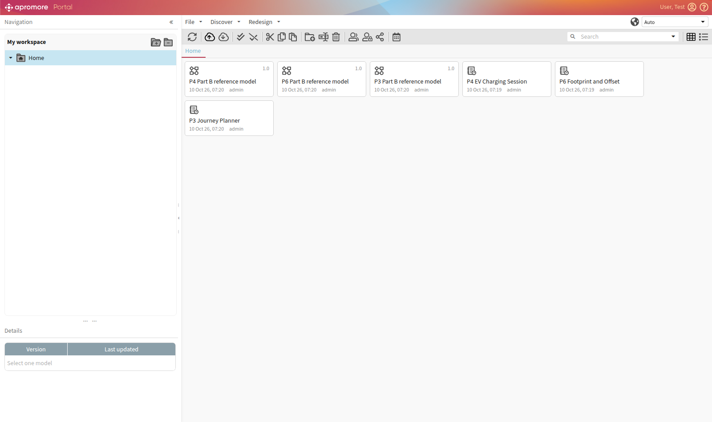
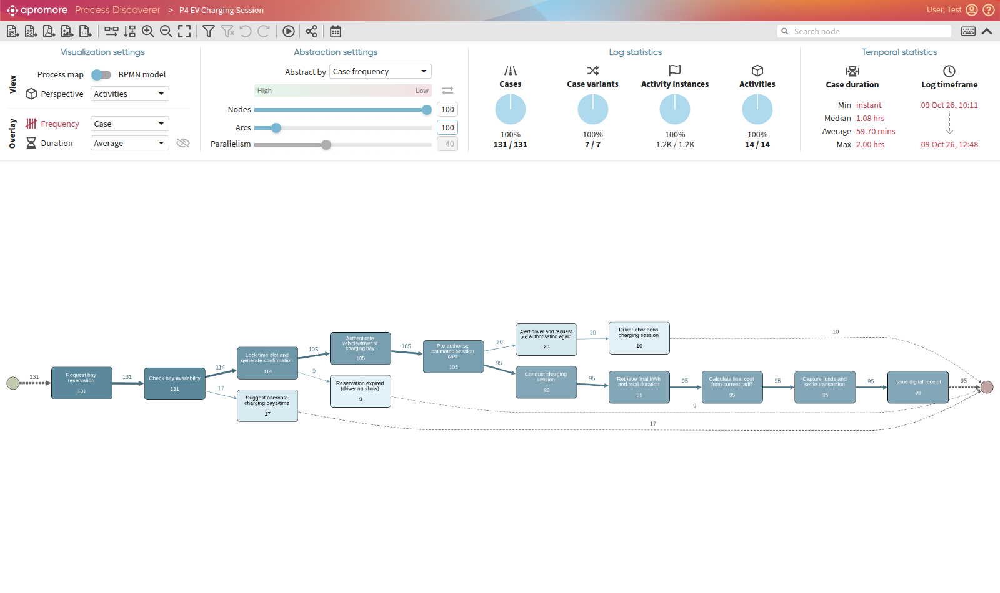
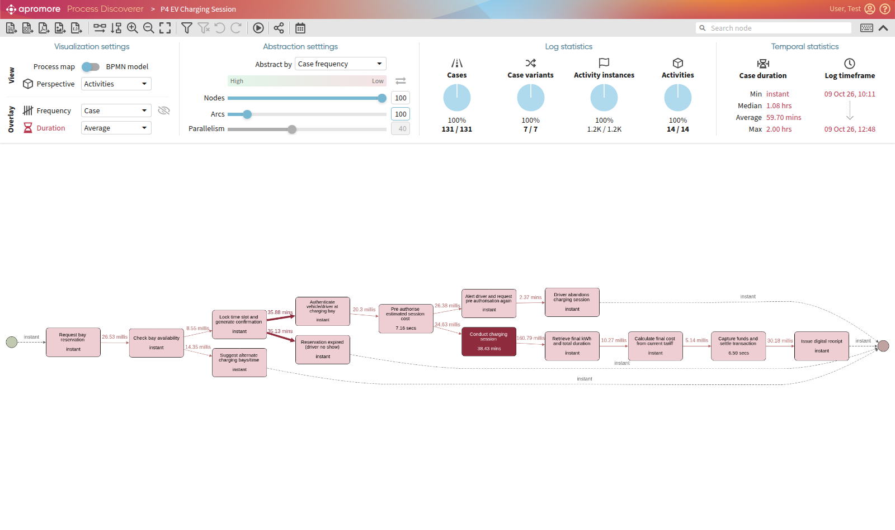
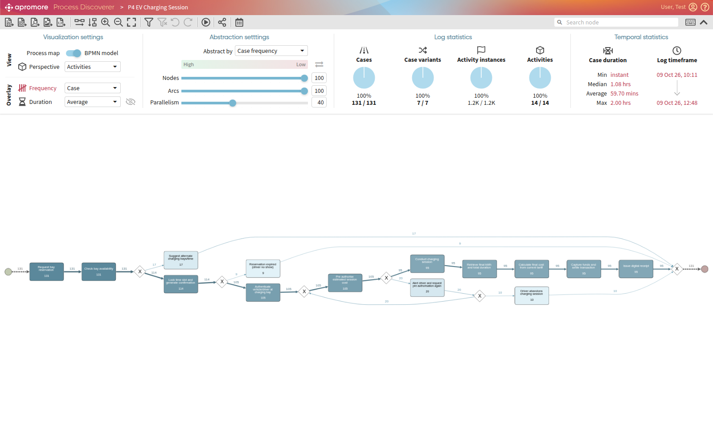
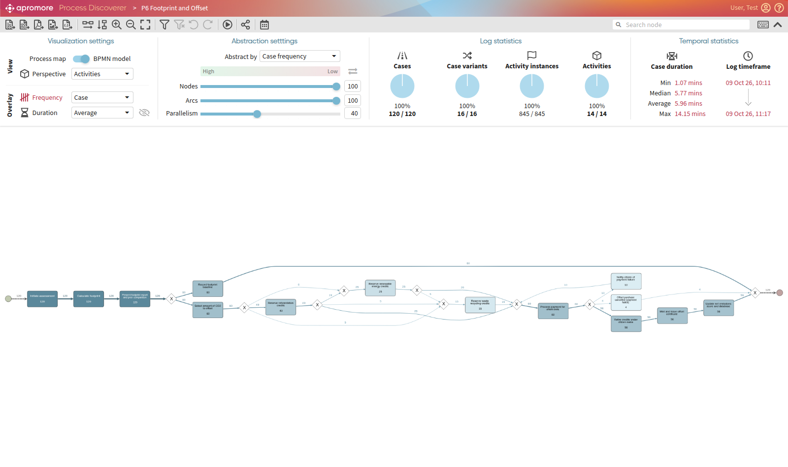

PART F

**NetZero Hub — Service-Oriented Software Engineering**

**Part F — Service / Process Analytics**

## F.0 Approach and Process Selection

Part F asks for at least three Part B business processes to be executed to generate event logs, mined with process-mining tools, and the procedure and outcomes demonstrated in detail. We mine the three processes that Part E implements as running microservices:

| Part B process | Executed by (Part E) | Why it is worth mining |
| --- | --- | --- |
| Process 3 — Carbon-Optimised Journey Planner | `journey-planner-service` | Parallel split/join (3.2/3.7) and an inclusive gateway (3.10/3.11): tests whether mining recovers concurrency |
| Process 4 — EV Charging Session | `ev-reservation-service` + `ev-billing-service` (RabbitMQ) | Exclusive choice (4.3), a retry loop (4.7a), an asynchronous hand-off between two services, and long human waiting times |
| Process 6 — Carbon Footprint & Offset Purchase | `footprint-service` + `offset-service` (RabbitMQ) | Exclusive choice (6.4), inclusive split over project types (6.6/6.7), a payment retry loop (6.9), and one case spanning two services |

The logs are not synthetic. Each process is executed by the real, running microservices from Part E, and every event is written by the service that performed the activity. A simulator only plays the human and external actors (drivers, citizens, card issuers) and makes their decisions stochastically. This matters for analytics: the logs contain genuine service behaviour (asynchronous delivery over RabbitMQ, real concurrency, real retries and idempotency) as well as the variation that business users introduce.



*Figure F.1 — Part F pipeline: simulator → Part E services → process-event logs → exporter (XES/CSV) → Disco, Apromore and a scripted pm4py analysis.*

The whole pipeline is one command (`./partf.sh`, see F.6). The numbers in this section come from the run with `CASES=120 SEED=2026`; the same seed reproduces the same decisions. A snapshot of that run's logs and results is kept in `docs/part-f-results/`.

## F.1 Process Execution (Simulation over the Real Services)

`tools/simulator/simulate.mjs` drives the stack through the API gateway exactly as a client application would. For each process it generates cases as a Poisson arrival stream (mean inter-arrival 0.4 s) and runs them concurrently, so cases genuinely overlap in time, as they would in production.

**Actor decisions.** Each case makes its decisions with a seeded random generator (mulberry32), so a run is reproducible:

| Process | Decision point (Part B) | Simulated behaviour |
| --- | --- | --- |
| 3 | Traveller constraints (3.10) | 45% set a time budget of 20–75 min; 20% refuse to cycle; 14 Illawarra/Sydney locations, about one pair in four has no rail link, and bike share is offered only for trips of 15 km or less |
| 4 | Bay available? (4.3) | 8 stations × 5 days × peak-weighted slots (07:00–19:00); 30% of bookings are 60 min, so overlaps arise naturally rather than being scripted. Half of rejected drivers immediately try a suggested alternate station (a new case) |
| 4 | Driver arrives | 10–60 min after booking; 7% never arrive (no-show) |
| 4 | Pre-auth approved? (4.7) | Card behaviour: 82% approve, 10% decline once, 4% decline twice, 4% always decline. After a decline, drivers retry; after 2–3 declines they may give up |
| 4 | Charging (4.8) | 20–60 min, 0.35–0.9 kWh per minute |
| 6 | Purchase offsets now? (6.4) | 75% say yes if the footprint is above 10 t CO₂-e/yr, otherwise 50% |
| 6 | Project types (6.6) | Reforestation 70%, renewable 50%, waste recycling 30% (at least one) |
| 6 | Payment successful? (6.9) | 84% approve, 8% decline once, 4% decline twice, 4% always decline (cancelled after 3 retries) |

**Time compression.** Human and physical waiting times are compressed so that 360 cases run in about 2.5 minutes: **one wall-clock second stands for one simulated minute**. The exporter undoes this with `TIME_SCALE=60` (t′ = t₀ + (t − t₀) × 60), a linear transform that preserves every ordering and every ratio between durations, so Disco and Apromore show business-scale durations (a 40-minute charging session reads as 40 minutes). Automated service steps are scaled by the same factor, so for real service response times we use the unscaled logs in `exports/raw/` (F.4.4).

**Execution outcome (seed 2026, 120 cases per process):**

| Process | Outcomes |
| --- | --- |
| 3 — Journey Planner | 55 plans with 2 options, 26 with 1, 24 with 3, 15 where no mode met the constraint and the fastest was kept |
| 4 — EV Charging | 131 cases (120 + 11 retries at an alternate station): 95 charged and billed, 17 rejected (bay unavailable), 10 abandoned after declined pre-authorisation, 9 no-shows |
| 6 — Footprint & Offset | 60 baseline only (declined), 56 offsets certified (32 with one project type, 20 with two, 4 with three), 4 cancelled after repeated payment failure |

## F.2 The Event Logs

Every service appends one JSON line per BPMN activity to `logs/<service>.jsonl` (design in Part E §E.5). `tools/log-exporter` merges the services' files, groups events by process and then by case, sorts each case chronologically and writes, per process:

| File | Format | Best for |
| --- | --- | --- |
| `<process>.xes` | XES 1.0 (IEEE 1849) with Concept, Lifecycle, Organizational and Time extensions | Disco, Apromore, ProM, pm4py: imports with no mapping |
| `<process>.activities.csv` | One row per activity instance, with `Start Timestamp` and `Complete Timestamp` | CSV import into Disco/Apromore with activity durations |
| `<process>.csv` | One row per event, lifecycle as a column, all event data flattened to `data.*` columns | Spreadsheet inspection, attribute filtering |

| Log attribute | XES key | Source |
| --- | --- | --- |
| Case ID | `concept:name` (trace) | reservation id (P4), footprint assessment id (P6), request id (P3) |
| Activity | `concept:name` (event) | BPMN task label from the Part B diagram |
| Lifecycle | `lifecycle:transition` | `start` / `complete` (start events only where an activity has real duration) |
| Resource | `org:resource` | BPMN lane, e.g. RSVP Management, Billing, Citizen, Verified Carbon Registry |
| Timestamp | `time:timestamp` | generated by the service at the moment the activity started/completed |
| BPMN reference, service | `bpmnRef`, `service` | Part B element number; the microservice that logged the event |
| Case outcome, user | `outcome`, `userId` (trace) | final activity of the case; the citizen/driver |

| Log | Cases | Events | Activity instances | Variants |
| --- | --- | --- | --- | --- |
| `carbon-optimized-journey-planner` | 120 | 1,526 | 1,063 | 23 |
| `ev-charging-session` | 131 | 1,483 | 1,161 | 7 |
| `environmental-services` | 120 | 1,072 | 845 | 20 |

**Data-quality checks** made before mining: every case belongs to exactly one process instance (a rejected booking is its own case and never merges with the booking that blocked it); cross-service cases are continuous (P4: reservation → billing, P6: footprint → offset → footprint), with no orphan fragments; every `start` has a matching `complete`; and events within each case are in chronological order.

## F.3 Tools and Method

Two process-mining tools analyse the same XES logs independently. Apromore is the interactive tool from the lectures; pm4py makes every number reproducible from a script and adds the conformance checking that Apromore's open-source edition does not include. Disco is described as an equivalent alternative for team members on Windows or macOS.

| Tool | How it was run | Used for |
| --- | --- | --- |
| **Apromore** Community Edition 8.1 | Locally in Docker (`tools/apromore/`, http://localhost:8181) | Process maps with frequency and duration overlays, BPMN discovery (Split Miner), log statistics, filtering, log animation, viewing the Part B reference models |
| **pm4py** 2.7 (`analytics/mine.py`) | In its own container (`docker compose run --rm process-miner`) | Scripted discovery (DFG, Inductive Miner), alignment-based conformance against the Part B models, performance and organisational analysis |
| **Disco** (Fluxicon), optional | Desktop app, Windows/macOS, free academic licence | The same map/variant/performance analysis as Apromore's Process Discoverer |

The Part B models are encoded for conformance checking as process trees in `analytics/mine.py` (sequence, exclusive choice, parallel, and loops for the retry cycles). `mine.py` also exports them as BPMN 2.0 XML (`<process>/reference-model.bpmn`), and those files were imported into Apromore next to the logs. Activities that the system logs but Part B does not model (no-show, abandonment, purchase cancellation) are deliberately left out of the reference models, so that conformance checking can find them.

### F.3.1 Apromore — what was done

The full procedure is in `tools/apromore/README.md`; the screenshots are in `docs/part-f-results/apromore/`.

1. **Start and import.** `docker compose -f tools/apromore/docker-compose.yml up -d`, log in, then *Upload* the three `.xes` logs and the three `reference-model.bpmn` files. Apromore imports XES with no column mapping (Figure F.6).
2. **Process Discoverer, frequency overlay.** Select a log → *Discover → Discover model*. Raise *Arcs* to 100% (the default of 10% hides infrequent arcs such as the retry loops) and fit the map to the screen. Each activity and arc shows its case frequency.
3. **Duration overlay.** Switch the primary overlay to *Duration (average)* to show the mean time on every arc and activity. This is the performance view used to find bottlenecks.
4. **BPMN view.** Flip *Process map → BPMN model*. Apromore runs Split Miner on the log and draws a BPMN model with gateways. Compare it with the Part B diagram and with the reference model opened through *Discover → Edit model*.
5. **Filtering and animation.** *Filter* narrows the log (for example, the trace attribute `outcome` ≠ `Issue digital receipt` keeps only unsuccessful EV cases). *Animate* replays the cases as tokens on the map. Animation is shown live in the demo, since it doesn't come across in a still image.

Apromore Community Edition has no conformance checker (that is in the commercial edition), so fitness, precision and deviation counts come from pm4py (F.4). The visual comparison between Apromore's discovered model and the imported reference model shows the same gaps.

### F.3.2 Disco (alternative) — step by step

1. **Import.** *Open file* → a `.xes` file → *Start import*. The XES needs no mapping. For CSV, open `<process>.activities.csv` and map *Case ID* → Case, *Activity* → Activity, both *Start Timestamp* and *Complete Timestamp* → Timestamp (pattern `yyyy-MM-dd'T'HH:mm:ss.SSSX`), and *Resource* → Resource.
2. **Map.** *Activities* and *Paths* at 100% give the full map, equivalent to Apromore at 100%/100%. Switch the overlay to *Performance → Mean duration* for the performance view.
3. **Statistics and Cases.** Case-duration distribution, activity frequencies and the variant list (P4: Variant 1 = 85 cases).
4. **Filters.** An *Attribute* filter on `outcome` (everything except `Issue digital receipt`) isolates the 36 unsuccessful EV cases; a *Follower* filter "Alert driver… eventually followed by Driver abandons charging session" isolates the abandonments.
5. **Animation.** *Animate* replays the log on the map.

### F.3.3 pm4py — scripted analysis

`analytics/mine.py` runs inside its own container (`docker compose run --rm process-miner`). For each log it:

- profiles the log (cases, events, variants, outcomes, case durations);
- discovers a directly-follows graph (frequency and performance), and a BPMN model with the Inductive Miner;
- replays the log on the Part B reference model with alignments, reporting fitness, precision and every deviation by activity, and compares against the discovered model;
- computes activity service times from start/complete pairs, the slowest transitions, a resource × activity matrix and hand-over-of-work counts.

Results go to `analysis/RESULTS.md` (snapshot: `docs/part-f-results/RESULTS.md`), with every figure referenced below.

## F.4 Results

### F.4.1 Summary

| Process | Cases | Variants | Fitness vs Part B | Precision vs Part B | Deviating cases | Mean case duration |
| --- | --- | --- | --- | --- | --- | --- |
| 3 — Journey Planner | 120 | 23 | 1.000 | 0.917 | 0 | 0.8 min* |
| 4 — EV Charging Session | 131 | 7 | 0.938 | 0.997 | 19 (14.5%) | 59.7 min |
| 6 — Footprint & Offset | 120 | 20 | 0.988 | 0.923 | 4 (3.3%) | 6.0 min |

\* Process 3 is fully automated, so its "duration" is the service's response time multiplied by the time scale: a 0.78 s mean response (F.4.4).

### F.4.2 Process 3 — Carbon-Optimised Journey Planner


*Figure F.2 — Process 3, directly-follows graph (frequency).*

- **Discovery recovers the parallelism.** The 23 variants are not 23 different behaviours. They are interleavings of the same behaviour: the timetable and emission-factor retrievals finish in either order (80 cases emission factors first, 40 timetable first), and the qualifying modes are prepared concurrently in any order. The Inductive Miner model (`discovered-bpmn.png`) puts both retrievals in a parallel block and the three mode preparations in a parallel block of optional branches, which is the Part B structure of 3.2/3.7 and 3.10/3.11.
- **Conformance: perfect fitness (1.000).** Every one of the 120 cases is allowed by the Part B model. Precision is 0.917 rather than 1 because our encoding of the inclusive gateway (each branch optional) also allows "no mode prepared", which never happens: the service enforces Part B's invariant that at least one mode always qualifies (15 cases needed the fallback).
- **Inclusive gateway in practice:** bus was prepared in 104 cases, train in 85 and bike share in 34. The time-budget constraint was the main reason options were dropped.

### F.4.3 Process 4 — EV Charging Session


*Figure F.3 — Process 4, directly-follows graph (frequency). The happy path carries 85 of 131 cases; rejection, no-show, retry and abandonment branches are visible.*


*Figure F.4 — Process 4 variants.*

- **Variants.** V1, the Part B happy path, covers 85 cases (65%). V2, rejected at 4.3 with alternates suggested, covers 17 (13%). V3, the no-show, covers 9 (7%). V4, one declined pre-authorisation then success, covers 8 (6%). V5 and V6, two or three declines then abandonment, cover 10 (8%). V7, three declines then success, covers 2.
- **Conformance: fitness 0.938; 19 cases (14.5%) deviate from the Part B model.** The alignments name the two gaps in Process 4:
  1. **Driver no-show (9 cases).** Part B's timer "Await vehicle arrival" has no path for a driver who never arrives. The alignment reports *Reservation expired (driver no-show)* as a log move. It also reports *Lock time slot…* as a log move and *Suggest alternate…* as a model move: the cheapest way to fit a confirmed-then-expired case into a model with no expiry path is to pretend it was rejected.
  2. **Abandonment after declined pre-authorisation (10 cases).** Part B's 4.7a loop has no exit, so it implicitly assumes every driver eventually pays. The alignment reports *Driver abandons charging session* (and the extra *Alert driver…*) as log moves, and every Billing task 4.8–4.12 as a skipped model move.
  The discovered model fits all cases (1.000), but at lower precision (0.826 vs 0.996): it generalises beyond what was observed, the usual fitness/precision trade-off.
- **Performance** (simulated time):

| Measure | Mean | Median |
| --- | --- | --- |
| Booking → arrival (Lock 4.4 → Authenticate 4.5) | 35.9 min | 37.6 min |
| Charging session (4.8 start → complete) | 38.4 min | 39.6 min |
| No-show detected after booking | 35.1 min | 30.3 min |
| Alert 4.7a → retry 4.6 | 1.5 min | 1.4 min |
| Alert 4.7a → abandon | 2.4 min | 2.4 min |
| Pre-authorisation 4.6, capture 4.11 (service time) | 0.1 min | 0.1 min |

  Almost all of the 59.7-minute mean case duration is customer time (travelling and charging). The platform's own steps are not the bottleneck: pre-authorisation and capture take seconds, and the asynchronous billing hand-off is milliseconds (F.4.4).
- **Organisational.** The hand-over network is EV Owner → RSVP Management (131) → Billing (95). The 10 hand-overs from RSVP Management back to the EV Owner are exactly the abandonments: the driver, not the platform, ends those cases.

### F.4.4 Service performance (unscaled logs)

From `exports/raw/` (real wall-clock timing of the running microservices):

| Interaction | n | Mean | Median | p95 |
| --- | --- | --- | --- | --- |
| Reservation 4.1 → 4.4 (synchronous, inc. overlap-checking transaction) | 114 | 0.6 ms | 1 ms | 1 ms |
| **RabbitMQ hop**: session ended (reservation-service) → billing 4.9 (billing-service) | 95 | 2.7 ms | 3 ms | 5 ms |
| Billing 4.9 → receipt 4.12 (inc. capture at the payment gateway) | 95 | 111 ms | 103 ms | 167 ms |
| Offset 6.5 → first credit reservation (offset.requested round trip) | 49 | 3.5 ms | 2 ms | 8 ms |
| Certificate 6.12 → score updated 6.13 (HTTP callback to footprint-service) | 56 | 2.7 ms | 2 ms | 6 ms |
| Offset purchase end to end, 6.5 → 6.13 | 56 | 2.12 s | 1.93 s | 4.89 s |
| Journey plan 3.1 → 3.13 | 120 | 776 ms | 786 ms | 933 ms |

The asynchronous decoupling costs almost nothing (a few milliseconds per broker hop). End-to-end time is dominated by the external systems: the registry retirement (about 1.2 s) in P6, and payment-decline back-off in the long tail (p95 4.9 s). The journey planner's response time is the slower of its two parallel upstream calls (timetable, mean 0.5 s) plus mode preparation. Running the calls in parallel saves roughly the 0.4 s that the emission-factor call would add if they ran in sequence.

### F.4.5 Process 6 — Carbon Footprint Calculation & Offset Purchase


*Figure F.5 — Process 6, BPMN discovered by the Inductive Miner: exclusive choice after the report, optional parallel project-type reservations, the payment retry loop, and the unmodelled cancellation exit.*

- **One case across two services.** All 120 cases run from *Initiate assessment* (footprint-service) through the offset marketplace (offset-service) and, when certified, back to *Update net emissions score* (footprint-service). This confirms the cross-service correlation designed in Part E.
- **Decision 6.4.** Exactly half of the citizens declined (60 cases, V1: report → *Record footprint baseline*). Decision-point analysis on the `totalCo2KgYear` attribute (the `data.totalCo2KgYear` column of `environmental-services.csv`, filtered in Disco or a spreadsheet) shows uptake of 81% (21/26) above 10 t/yr and 41% (39/94) at or below it. This recovers the decision rule built into the simulator, which shows the attribute-level analysis works. With real users, the same analysis would show which citizens respond to the offer.
- **Inclusive gateway 6.6/6.7.** Reforestation was reserved in 49 purchases, renewable in 25 and waste recycling in 15. Variants V2–V6 differ only in which project types were chosen and the order in which their concurrent reservations completed.
- **Conformance: fitness 0.988; 4 cases deviate.** All four are *Offset purchase cancelled (payment failed)*: Part B's 6.9 loop retries forever, while the implementation stops after three retries. The alignment marks the cancellation as a log move and 6.10–6.13 as skipped.
- **Performance.** The longest system step is *Retire credits under citizen name* (mean 1.2 min simulated, about 1.2 s real), the registry round trip. Each payment decline adds a 1.9-minute back-off before the retry. The longest waits overall are the citizen's thinking time between the report and their decision (5.8 min to buy, 3.7 min to decline).

### F.4.6 Apromore results and cross-validation



*Figure F.6 — Apromore portal (local Docker instance) with the three event logs and three Part B reference models imported.*

Apromore's Process Discoverer computes its statistics independently from the same XES files. Its figures agree with pm4py on every measure that both tools define the same way:

| Measure | Process | Apromore | pm4py |
| --- | --- | --- | --- |
| Cases | P4 / P6 / P3 | 131 / 120 / 120 | 131 / 120 / 120 |
| Activities | P4 | 14 | 14 |
| Mean case duration | P4 | 59.70 min | 59.7 min |
| Mean case duration | P6 | 5.96 min | 6.0 min |
| Mean case duration | P3 | 46.58 s (≈0.78 min) | 0.8 min |
| Mean time, booking → arrival (Lock → Authenticate) | P4 | 35.88 min | 35.9 min |
| Mean charging session duration | P4 | 38.43 min | 38.4 min |
| Variants | P4 / P6 / P3 | 7 / 16 / 5 | 7 / 20 / 23 |

The variant counts differ only for the processes with concurrency, and the difference is explained by how each tool orders events. Apromore merges every start/complete pair into one activity instance and orders instances by *start* time. The pm4py analysis orders by *completion*. In P3, both upstream retrievals start in the same millisecond, so Apromore always sees them in the same order and finds 5 variants: exactly the five distinct combinations of transport modes prepared at the inclusive gateway. pm4py also distinguishes which retrieval and which mode preparation *finished* first, giving 23 interleavings of the same 5 behaviours. P6 is the same effect on a smaller scale, with the concurrent credit reservations completing in a different order from the one in which they started.



*Figure F.7 — Apromore Process Discoverer, P4 frequency overlay (arcs 100%). The happy path carries 95 of 131 cases; the rejection (17), no-show (9), pre-authorisation retry (20 cases) and abandonment (10) branches are all visible.*



*Figure F.8 — P4 duration overlay. The two dark arcs and the dark activity are the human waiting times (booking → arrival, about 36 min; the charging session, 38.4 min). All system steps take milliseconds to seconds.*



*Figure F.9 — BPMN model discovered by Apromore (Split Miner) from the P4 log. Compare with the Part B reference model imported into Apromore (`part-f-results/apromore/p4-0-reference-model.png`): the discovered model has an extra exclusive branch after "Lock time slot…" (the no-show) and an exit from the pre-authorisation loop (the abandonment). These are the two deviations the pm4py alignments report (F.4.3).*



*Figure F.10 — BPMN model discovered by Apromore from the P6 log: the exclusive choice at 6.4 (60 baseline / 60 purchase), the optional and concurrent project-type reservations, the payment retry loop, and the cancellation exit that Part B lacks.*

The P3 and P6 frequency/duration maps and the P3 discovered model are in `docs/part-f-results/apromore/` (`p3-*`, `p6-*`).

## F.5 Insights and Recommendations

Process mining was used here both to analyse the processes and to check the design. The findings feed back into the earlier parts:

1. **Part B Process 4 should model the no-show.** 7% of confirmed reservations expired. Add a timer boundary event on "Await vehicle arrival" (grace period) leading to "Release slot" and an end event "Reservation expired". Operationally, each no-show holds a bay for about 35 minutes while the same station pool turned away 13% of booking requests. A no-show fee or a shorter grace period would free capacity.
2. **Part B Process 4's retry loop needs an exit.** 10 of the 105 drivers who arrived (9.5%) abandoned after declined pre-authorisations. Add an exit from 4.7a ("Driver cancels") with an end event, and consider offering a second payment method in the alert, since the alert-to-retry loop resolves within about 1.5 minutes when it succeeds.
3. **Part B Process 6 should bound its payment retries.** The model loops on 6.9 indefinitely. The implementation (and any real payment gateway) gives up. Model "after n failures → Cancel purchase → Release reserved credits", which also keeps the reserved credits from being locked forever.
4. **The microservice boundaries hold up under analysis.** The hand-over networks match the BPMN lanes one to one (RSVP Management → Billing, Offset Marketplace → Registry → Assessment Service), and the asynchronous hops cost milliseconds. The cost of splitting each process across two services is negligible compared with the external dependencies.
5. **Bottlenecks are external, so effort belongs there.** To speed up offset certification, work on the registry integration (for example, batch retirements, or certify optimistically and reconcile later). To speed up journey planning, cache the timetable feed, which is the slowest of the two parallel calls.

## F.6 Reproducing the Analysis

```bash
./partf.sh                      # stack up → simulate 120 cases/process → export → mine
CASES=200 SEED=7 ./partf.sh     # a different/larger run
```

To analyse a fresh run in Apromore, start it with `docker compose -f tools/apromore/docker-compose.yml up -d` and upload the new `exports/*.xes` (see `tools/apromore/README.md`).

`partf.sh` archives earlier logs to `logs/archive/<timestamp>/` before simulating, so each run's log is clean. Outputs: `exports/*.xes`, `*.csv`, `*.activities.csv` (business-time logs for Disco/Apromore), `exports/raw/` (unscaled), and `analysis/RESULTS.md` plus figures and `reference-model.bpmn` per process. Each step can also be run on its own: `docker compose run --rm simulator`, `docker compose run --rm -e TIME_SCALE=60 log-exporter`, `docker compose run --rm process-miner`.

## F.7 Limitations

- Human and external behaviour is simulated. Rates such as no-shows, card declines and offset uptake are assumptions, chosen to be plausible and to exercise every branch, so the business findings in F.5 are illustrative. The service-performance figures (F.4.4) are measured, but on one machine with mocked external systems.
- Time is compressed 60× and re-expanded linearly, so durations of human activities are accurate in proportion, but the absolute service latencies in the scaled logs are inflated (hence F.4.4 uses the raw logs).
- The reference models are hand-encoded from the Part B diagrams, and the inclusive gateways are approximated as parallel optional branches (the reason for the 0.917/0.923 precision values in P3/P6).
