# Part F — Process Mining Results

Generated by `analytics/mine.py` (pm4py 2.7.23.9) from the XES logs in `/data/exports`. Durations are in simulated minutes (logs exported with TIME_SCALE=60).

## Summary

| Process | Cases | Events | Variants | Fitness vs Part B | Precision vs Part B | Deviating cases | Mean case duration |
| --- | --- | --- | --- | --- | --- | --- | --- |
| Process 3 — Carbon-Optimized Journey Planner | 120 | 1526 | 23 | 1.000 | 0.917 | 0 | 0.8 min |
| Process 4 — EV Charging Session | 131 | 1483 | 7 | 0.938 | 0.997 | 19 | 59.7 min |
| Process 6 — Carbon Footprint Calculation & Offset Purchase | 120 | 1072 | 20 | 0.988 | 0.923 | 4 | 6.0 min |

## Process 3 — Carbon-Optimized Journey Planner

Source log: `carbon-optimized-journey-planner.xes` · 120 cases · 1526 events (1063 activity instances) · 23 variants · mean case duration 0.8 min, median 0.8 min.

### Case outcomes

| Final activity (case outcome) | Cases | Share |
| --- | --- | --- |
| Present ranked journey plan | 120 | 100% |

### Most frequent variants

| # | Cases | Share | Variant (activity sequence) |
| --- | --- | --- | --- |
| V1 | 16 | 13% | Submit trip request → Retrieve per-mode emission factors → Retrieve scheduled services and real-time data → Calculate candidate routes across all modes → Append CO2-e estimate to each route → Prepare bus options → Rank options by CO2 ascending → Present ranked journey plan |
| V2 | 16 | 13% | Submit trip request → Retrieve per-mode emission factors → Retrieve scheduled services and real-time data → Calculate candidate routes across all modes → Append CO2-e estimate to each route → Prepare train options → Prepare bus options → Rank options by CO2 ascending → Present ranked journey plan |
| V3 | 14 | 12% | Submit trip request → Retrieve per-mode emission factors → Retrieve scheduled services and real-time data → Calculate candidate routes across all modes → Append CO2-e estimate to each route → Prepare train options → Rank options by CO2 ascending → Present ranked journey plan |
| V4 | 14 | 12% | Submit trip request → Retrieve per-mode emission factors → Retrieve scheduled services and real-time data → Calculate candidate routes across all modes → Append CO2-e estimate to each route → Prepare bus options → Prepare train options → Rank options by CO2 ascending → Present ranked journey plan |
| V5 | 11 | 9% | Submit trip request → Retrieve scheduled services and real-time data → Retrieve per-mode emission factors → Calculate candidate routes across all modes → Append CO2-e estimate to each route → Prepare bus options → Prepare train options → Rank options by CO2 ascending → Present ranked journey plan |
| V6 | 9 | 8% | Submit trip request → Retrieve scheduled services and real-time data → Retrieve per-mode emission factors → Calculate candidate routes across all modes → Append CO2-e estimate to each route → Prepare bus options → Rank options by CO2 ascending → Present ranked journey plan |

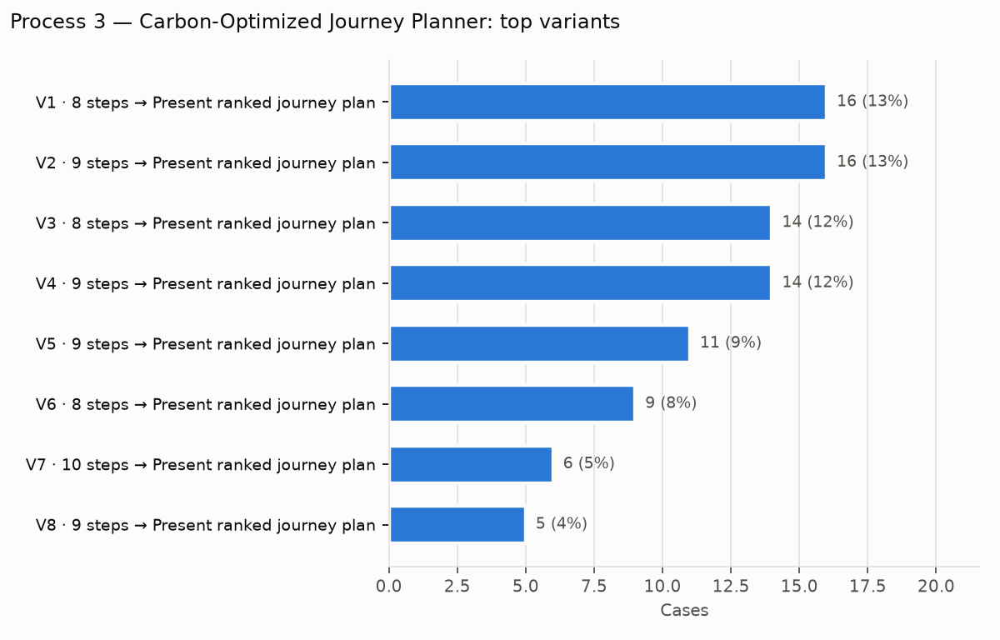

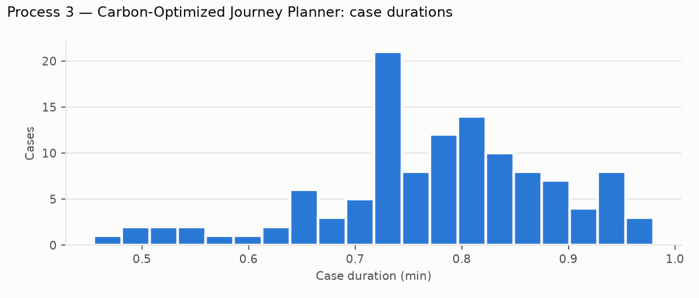

### Discovery

Directly-follows graph with frequencies (equivalent to Disco's map at 100% activities / 100% paths):

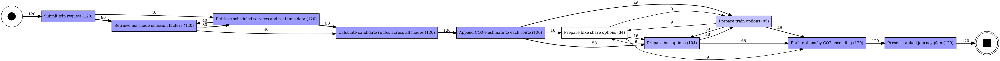

Directly-follows graph with mean transition times (Disco's performance view):

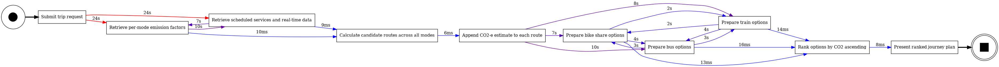

BPMN model discovered with the Inductive Miner (comparable to Apromore's BPMN discovery):

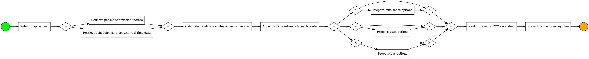

### Conformance against the Part B reference model

Reference model (encoded from the Part B BPMN diagram): 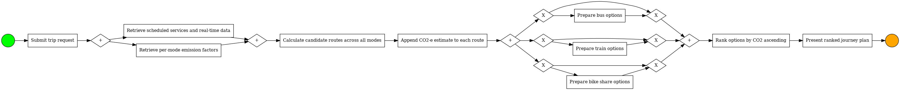

| Model | Fitness (alignments) | Perfectly fitting cases | Precision |
| --- | --- | --- | --- |
| Part B reference model | 1.000 | 100.0% | 0.917 |
| Discovered (Inductive Miner) | 1.000 | 100.0% | 0.917 |

0 of 120 cases deviate from the Part B model:

| Deviation | Activity | Count |
| --- | --- | --- |
| none | — | 0 |

### Performance

Activity service times (from start/complete event pairs):

| Activity | Instances | Mean | Median | Max |
| --- | --- | --- | --- | --- |
| Retrieve scheduled services and real-time data | 120 | 0.5 min | 0.5 min | 0.7 min |
| Retrieve per-mode emission factors | 120 | 0.4 min | 0.5 min | 0.6 min |
| Prepare bus options | 104 | 0.2 min | 0.2 min | 0.3 min |
| Prepare train options | 85 | 0.2 min | 0.2 min | 0.3 min |
| Prepare bike share options | 34 | 0.2 min | 0.2 min | 0.3 min |

Slowest transitions between activities (waiting time, potential bottlenecks):

| From | To | Occurrences | Mean wait | Median wait |
| --- | --- | --- | --- | --- |
| Submit trip request | Retrieve scheduled services and real-time data | 40 | 0.4 min | 0.4 min |
| Submit trip request | Retrieve per-mode emission factors | 80 | 0.4 min | 0.4 min |
| Append CO2-e estimate to each route | Prepare bus options | 58 | 0.2 min | 0.2 min |
| Retrieve per-mode emission factors | Retrieve scheduled services and real-time data | 80 | 0.2 min | 0.2 min |
| Append CO2-e estimate to each route | Prepare train options | 46 | 0.1 min | 0.1 min |
| Append CO2-e estimate to each route | Prepare bike share options | 16 | 0.1 min | 0.1 min |

### Organisational perspective

Activity instances per resource (BPMN lane):

| Activity | Citizen | Routing Engine | Sustainability Analytics |
| --- | --- | --- | --- |
| Append CO2-e estimate to each route | 0 | 0 | 120 |
| Calculate candidate routes across all modes | 0 | 120 | 0 |
| Prepare bike share options | 0 | 34 | 0 |
| Prepare bus options | 0 | 104 | 0 |
| Prepare train options | 0 | 85 | 0 |
| Present ranked journey plan | 0 | 120 | 0 |
| Rank options by CO2 ascending | 0 | 120 | 0 |
| Retrieve per-mode emission factors | 0 | 0 | 120 |
| Retrieve scheduled services and real-time data | 0 | 120 | 0 |
| Submit trip request | 120 | 0 | 0 |

Hand-overs of work between resources:

| From | To | Hand-overs |
| --- | --- | --- |
| Sustainability Analytics | Routing Engine | 240 |
| Routing Engine | Sustainability Analytics | 160 |
| Citizen | Sustainability Analytics | 80 |
| Citizen | Routing Engine | 40 |

## Process 4 — EV Charging Session

Source log: `ev-charging-session.xes` · 131 cases · 1483 events (1161 activity instances) · 7 variants · mean case duration 59.7 min, median 64.8 min.

### Case outcomes

| Final activity (case outcome) | Cases | Share |
| --- | --- | --- |
| Issue digital receipt | 95 | 73% |
| Suggest alternate charging bays/time | 17 | 13% |
| Driver abandons charging session | 10 | 8% |
| Reservation expired (driver no-show) | 9 | 7% |

### Most frequent variants

| # | Cases | Share | Variant (activity sequence) |
| --- | --- | --- | --- |
| V1 | 85 | 65% | Request bay reservation → Check bay availability → Lock time slot and generate confirmation → Authenticate vehicle/driver at charging bay → Pre-authorise estimated session cost → Conduct charging session → Retrieve final kWh and total duration → Calculate final cost from current tariff → Capture funds and settle transaction → Issue digital receipt |
| V2 | 17 | 13% | Request bay reservation → Check bay availability → Suggest alternate charging bays/time |
| V3 | 9 | 7% | Request bay reservation → Check bay availability → Lock time slot and generate confirmation → Reservation expired (driver no-show) |
| V4 | 8 | 6% | Request bay reservation → Check bay availability → Lock time slot and generate confirmation → Authenticate vehicle/driver at charging bay → Pre-authorise estimated session cost → Alert driver and request pre-authorisation again → Pre-authorise estimated session cost → Conduct charging session → Retrieve final kWh and total duration → Calculate final cost from current tariff → Capture funds and settle transaction → Issue digital receipt |
| V5 | 5 | 4% | Request bay reservation → Check bay availability → Lock time slot and generate confirmation → Authenticate vehicle/driver at charging bay → Pre-authorise estimated session cost → Alert driver and request pre-authorisation again → Pre-authorise estimated session cost → Alert driver and request pre-authorisation again → Driver abandons charging session |
| V6 | 5 | 4% | Request bay reservation → Check bay availability → Lock time slot and generate confirmation → Authenticate vehicle/driver at charging bay → Pre-authorise estimated session cost → Alert driver and request pre-authorisation again → Pre-authorise estimated session cost → Alert driver and request pre-authorisation again → Pre-authorise estimated session cost → Alert driver and request pre-authorisation again → Driver abandons charging session |

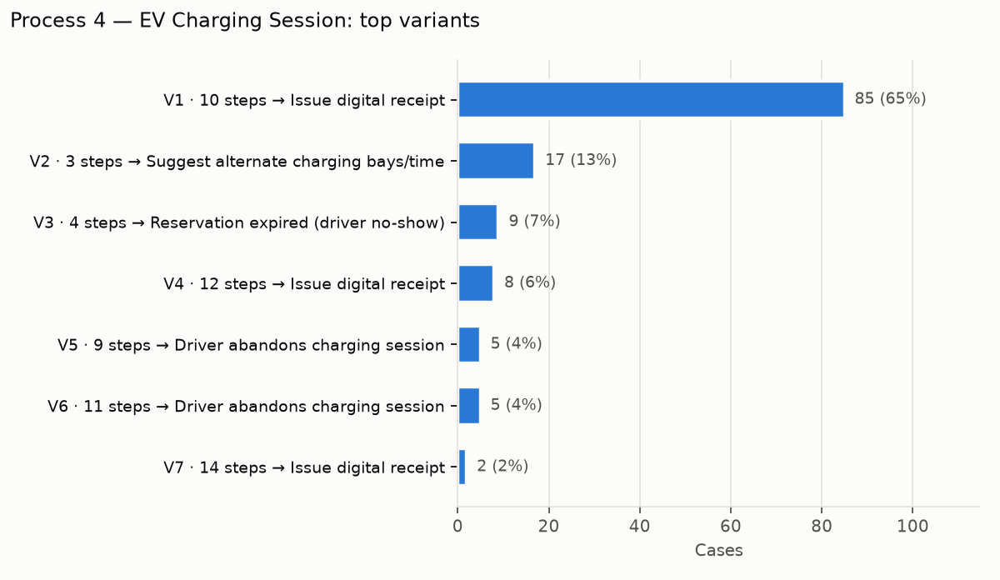

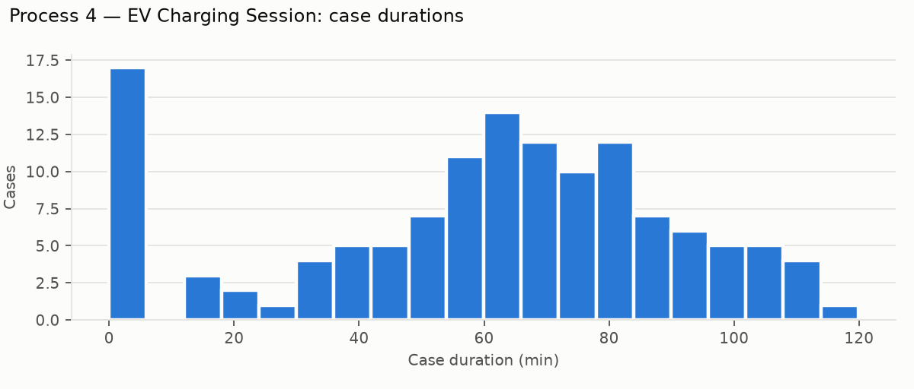

### Discovery

Directly-follows graph with frequencies (equivalent to Disco's map at 100% activities / 100% paths):

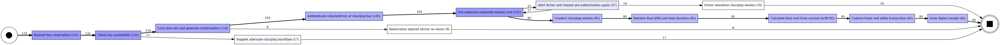

Directly-follows graph with mean transition times (Disco's performance view):

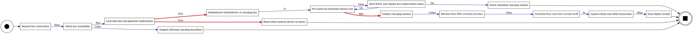

BPMN model discovered with the Inductive Miner (comparable to Apromore's BPMN discovery):

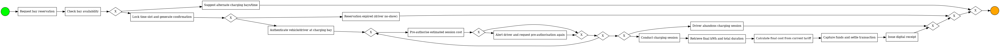

### Conformance against the Part B reference model

Reference model (encoded from the Part B BPMN diagram): 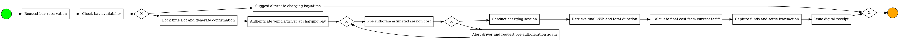

| Model | Fitness (alignments) | Perfectly fitting cases | Precision |
| --- | --- | --- | --- |
| Part B reference model | 0.938 | 85.5% | 0.996 |
| Discovered (Inductive Miner) | 1.000 | 100.0% | 0.826 |

19 of 131 cases deviate from the Part B model:

| Deviation | Activity | Count |
| --- | --- | --- |
| Observed but not allowed by Part B model (log move) | Alert driver and request pre-authorisation again | 10 |
| Observed but not allowed by Part B model (log move) | Driver abandons charging session | 10 |
| Observed but not allowed by Part B model (log move) | Lock time slot and generate confirmation | 9 |
| Observed but not allowed by Part B model (log move) | Reservation expired (driver no-show) | 9 |
| Required by Part B model but not observed (model move) | Conduct charging session | 10 |
| Required by Part B model but not observed (model move) | Retrieve final kWh and total duration | 10 |
| Required by Part B model but not observed (model move) | Calculate final cost from current tariff | 10 |
| Required by Part B model but not observed (model move) | Capture funds and settle transaction | 10 |
| Required by Part B model but not observed (model move) | Issue digital receipt | 10 |
| Required by Part B model but not observed (model move) | Suggest alternate charging bays/time | 9 |

### Performance

Activity service times (from start/complete event pairs):

| Activity | Instances | Mean | Median | Max |
| --- | --- | --- | --- | --- |
| Conduct charging session | 95 | 38.4 min | 39.6 min | 59.8 min |
| Pre-authorise estimated session cost | 132 | 0.1 min | 0.1 min | 0.2 min |
| Capture funds and settle transaction | 95 | 0.1 min | 0.1 min | 0.2 min |

Slowest transitions between activities (waiting time, potential bottlenecks):

| From | To | Occurrences | Mean wait | Median wait |
| --- | --- | --- | --- | --- |
| Pre-authorise estimated session cost | Conduct charging session | 95 | 38.4 min | 39.6 min |
| Lock time slot and generate confirmation | Authenticate vehicle/driver at charging bay | 105 | 35.9 min | 37.6 min |
| Lock time slot and generate confirmation | Reservation expired (driver no-show) | 9 | 35.1 min | 30.3 min |
| Alert driver and request pre-authorisation again | Driver abandons charging session | 10 | 2.4 min | 2.4 min |
| Alert driver and request pre-authorisation again | Pre-authorise estimated session cost | 27 | 1.5 min | 1.4 min |
| Authenticate vehicle/driver at charging bay | Pre-authorise estimated session cost | 105 | 0.1 min | 0.1 min |

### Organisational perspective

Activity instances per resource (BPMN lane):

| Activity | Billing | EV Owner | RSVP Management |
| --- | --- | --- | --- |
| Alert driver and request pre-authorisation again | 0 | 0 | 37 |
| Authenticate vehicle/driver at charging bay | 0 | 0 | 105 |
| Calculate final cost from current tariff | 95 | 0 | 0 |
| Capture funds and settle transaction | 95 | 0 | 0 |
| Check bay availability | 0 | 0 | 131 |
| Conduct charging session | 0 | 0 | 95 |
| Driver abandons charging session | 0 | 10 | 0 |
| Issue digital receipt | 95 | 0 | 0 |
| Lock time slot and generate confirmation | 0 | 0 | 114 |
| Pre-authorise estimated session cost | 0 | 0 | 132 |
| Request bay reservation | 0 | 131 | 0 |
| Reservation expired (driver no-show) | 0 | 0 | 9 |
| Retrieve final kWh and total duration | 95 | 0 | 0 |
| Suggest alternate charging bays/time | 0 | 0 | 17 |

Hand-overs of work between resources:

| From | To | Hand-overs |
| --- | --- | --- |
| EV Owner | RSVP Management | 131 |
| RSVP Management | Billing | 95 |
| RSVP Management | EV Owner | 10 |

## Process 6 — Carbon Footprint Calculation & Offset Purchase

Source log: `environmental-services.xes` · 120 cases · 1072 events (845 activity instances) · 20 variants · mean case duration 6.0 min, median 5.8 min.

### Case outcomes

| Final activity (case outcome) | Cases | Share |
| --- | --- | --- |
| Record footprint baseline | 60 | 50% |
| Update net emissions score and database | 56 | 47% |
| Offset purchase cancelled (payment failed) | 4 | 3% |

### Most frequent variants

| # | Cases | Share | Variant (activity sequence) |
| --- | --- | --- | --- |
| V1 | 60 | 50% | Initiate assessment → Calculate footprint → Present footprint report and peer comparison → Record footprint baseline |
| V2 | 20 | 17% | Initiate assessment → Calculate footprint → Present footprint report and peer comparison → Select amount of CO2 to offset → Reserve reforestation credits → Process payment for offset units → Retire credits under citizen name → Mint and issue offset certificate → Update net emissions score and database |
| V3 | 9 | 8% | Initiate assessment → Calculate footprint → Present footprint report and peer comparison → Select amount of CO2 to offset → Reserve reforestation credits → Reserve renewable energy credits → Process payment for offset units → Retire credits under citizen name → Mint and issue offset certificate → Update net emissions score and database |
| V4 | 4 | 3% | Initiate assessment → Calculate footprint → Present footprint report and peer comparison → Select amount of CO2 to offset → Reserve reforestation credits → Reserve waste recycling credits → Process payment for offset units → Retire credits under citizen name → Mint and issue offset certificate → Update net emissions score and database |
| V5 | 4 | 3% | Initiate assessment → Calculate footprint → Present footprint report and peer comparison → Select amount of CO2 to offset → Reserve renewable energy credits → Reserve reforestation credits → Process payment for offset units → Retire credits under citizen name → Mint and issue offset certificate → Update net emissions score and database |
| V6 | 4 | 3% | Initiate assessment → Calculate footprint → Present footprint report and peer comparison → Select amount of CO2 to offset → Reserve renewable energy credits → Process payment for offset units → Retire credits under citizen name → Mint and issue offset certificate → Update net emissions score and database |

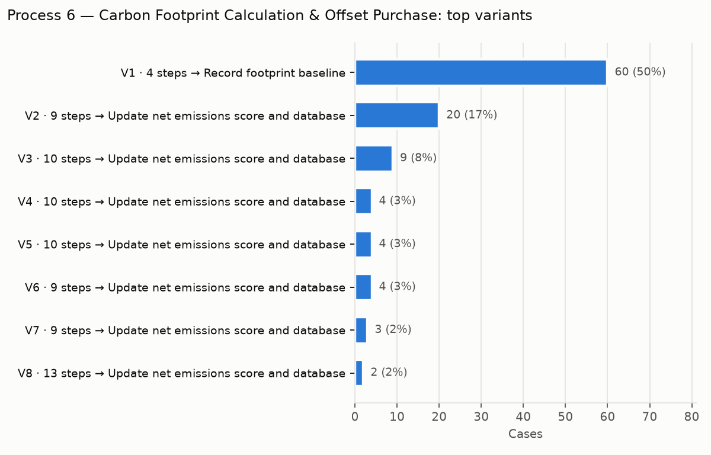

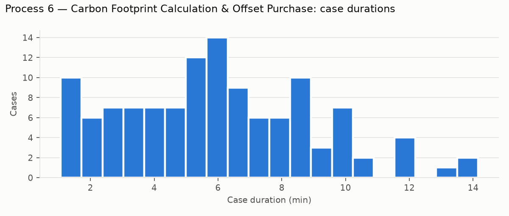

### Discovery

Directly-follows graph with frequencies (equivalent to Disco's map at 100% activities / 100% paths):

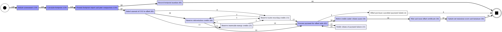

Directly-follows graph with mean transition times (Disco's performance view):

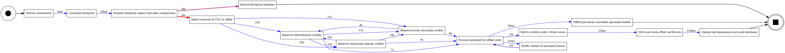

BPMN model discovered with the Inductive Miner (comparable to Apromore's BPMN discovery):

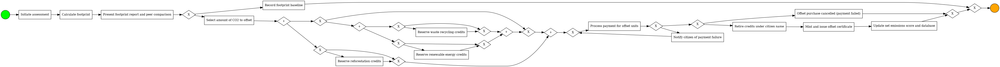

### Conformance against the Part B reference model

Reference model (encoded from the Part B BPMN diagram): 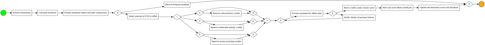

| Model | Fitness (alignments) | Perfectly fitting cases | Precision |
| --- | --- | --- | --- |
| Part B reference model | 0.988 | 96.7% | 0.923 |
| Discovered (Inductive Miner) | 1.000 | 100.0% | 0.874 |

4 of 120 cases deviate from the Part B model:

| Deviation | Activity | Count |
| --- | --- | --- |
| Observed but not allowed by Part B model (log move) | Offset purchase cancelled (payment failed) | 4 |
| Required by Part B model but not observed (model move) | Retire credits under citizen name | 4 |
| Required by Part B model but not observed (model move) | Mint and issue offset certificate | 4 |
| Required by Part B model but not observed (model move) | Update net emissions score and database | 4 |

### Performance

Activity service times (from start/complete event pairs):

| Activity | Instances | Mean | Median | Max |
| --- | --- | --- | --- | --- |
| Retire credits under citizen name | 56 | 1.2 min | 1.3 min | 1.6 min |
| Reserve waste recycling credits | 15 | 0.5 min | 0.5 min | 0.7 min |
| Reserve renewable energy credits | 25 | 0.4 min | 0.4 min | 0.6 min |
| Reserve reforestation credits | 49 | 0.4 min | 0.4 min | 0.7 min |
| Process payment for offset units | 82 | 0.1 min | 0.1 min | 0.2 min |

Slowest transitions between activities (waiting time, potential bottlenecks):

| From | To | Occurrences | Mean wait | Median wait |
| --- | --- | --- | --- | --- |
| Present footprint report and peer comparison | Select amount of CO2 to offset | 60 | 5.8 min | 5.7 min |
| Present footprint report and peer comparison | Record footprint baseline | 60 | 3.7 min | 3.6 min |
| Notify citizen of payment failure | Process payment for offset units | 22 | 1.9 min | 2.1 min |
| Process payment for offset units | Retire credits under citizen name | 56 | 1.2 min | 1.3 min |
| Select amount of CO2 to offset | Reserve reforestation credits | 39 | 0.4 min | 0.4 min |
| Select amount of CO2 to offset | Reserve waste recycling credits | 8 | 0.4 min | 0.4 min |

### Organisational perspective

Activity instances per resource (BPMN lane):

| Activity | Assessment Service | Citizen | Offset Marketplace | Verified Carbon Registry |
| --- | --- | --- | --- | --- |
| Calculate footprint | 120 | 0 | 0 | 0 |
| Initiate assessment | 0 | 120 | 0 | 0 |
| Mint and issue offset certificate | 0 | 0 | 56 | 0 |
| Notify citizen of payment failure | 0 | 0 | 22 | 0 |
| Offset purchase cancelled (payment failed) | 0 | 0 | 4 | 0 |
| Present footprint report and peer comparison | 120 | 0 | 0 | 0 |
| Process payment for offset units | 0 | 0 | 82 | 0 |
| Record footprint baseline | 60 | 0 | 0 | 0 |
| Reserve reforestation credits | 0 | 0 | 49 | 0 |
| Reserve renewable energy credits | 0 | 0 | 25 | 0 |
| Reserve waste recycling credits | 0 | 0 | 15 | 0 |
| Retire credits under citizen name | 0 | 0 | 0 | 56 |
| Select amount of CO2 to offset | 0 | 60 | 0 | 0 |
| Update net emissions score and database | 56 | 0 | 0 | 0 |

Hand-overs of work between resources:

| From | To | Hand-overs |
| --- | --- | --- |
| Citizen | Assessment Service | 120 |
| Assessment Service | Citizen | 60 |
| Citizen | Offset Marketplace | 60 |
| Offset Marketplace | Verified Carbon Registry | 56 |
| Verified Carbon Registry | Offset Marketplace | 56 |
| Offset Marketplace | Assessment Service | 56 |
